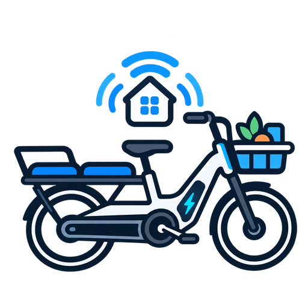

<p align="center"></p>

# tenways-ble

Small experimental Python library and CLI for local BLE access to TENWAYS e-bikes.

Read-only by design:

- discovers nearby TENWAYS BLE devices;
- decodes the proprietary **King Meter** frame protocol (CRC-16/MODBUS, TLV fields) used by the TENWAYS Longtail Duo;
- reads live telemetry: traction battery, odometer, trip, max/average speed, ride time;
- reads firmware and serial number;
- reads the standard Bluetooth Battery Level characteristic (`0x2A19`), which is **not** the traction battery;
- sends no lock, light or configuration commands; the only writes are two explicit ones the app also makes, the clock sync `set_clock()` and clearing the trip `reset_trip()` (see below).

The protocol was reconstructed from an Android HCI capture of the official TENWAYS app; all test vectors are the original captured frames. Live operation against the bike is still being validated.

## Library usage

```python
import asyncio
from tenways_ble import TenwaysBike

async def main():
    async with TenwaysBike("E8:88:6C:31:B3:0D") as bike:
        status = await bike.read_status()
        print(status.battery_percent, status.odometer_km)

asyncio.run(main())
```

`TenwaysBike` also accepts an already connected `BleakClient` (for example from `bleak-retry-connector` in Home Assistant). It then only speaks the protocol and leaves the connection to the caller.

The sans-I/O protocol module `tenways_ble.protocol` builds and parses frames without any Bluetooth dependency.

## Devices

| Device | Advertised name | Notes |
|---|---|---|
| Longtail Duo drive | `Longtail Duo` | King Meter service, telemetry source. Standard battery reads ~1 %, not the traction battery. |
| Separate BLE device | `Tenways-ble-XXXXXX` | HID service, standard battery 100 %, also exposes the King Meter service. Function unconfirmed (remote/control unit?). |

## Known GATT layout

Standard battery service:

- Service: `0000180f-0000-1000-8000-00805f9b34fb`
- Battery Level: `00002a19-0000-1000-8000-00805f9b34fb` (`READ`, `NOTIFY`)

King Meter service (`43480001-…` contains `KING METER` in ASCII):

- Service: `43480001-f001-4b49-4e47-204d45544552`
- Write: `43480002-f001-4b49-4e47-204d45544552` (`WRITE WITHOUT RESPONSE`)
- Notify: `43480003-f001-4b49-4e47-204d45544552` (`NOTIFY`)
- Read: `43480004-f001-4b49-4e47-204d45544552` (`READ`, no useful content observed)

## King Meter protocol

```
[TYPE] [00] [LEN] [COUNT] [PAYLOAD…] [CRC_HI] [CRC_LO] [45]
```

| Element | Meaning |
|---|---|
| TYPE | `0x62` read, `0x63` write |
| `00` | constant header byte |
| LEN | length of COUNT + PAYLOAD; frame length is LEN + 6 |
| COUNT | number of keys: keys asked for in a read request, `[key][size][value]` entries in a reply, `1` in a write. Not a command code (earlier versions of this library called it `CMD`) |
| CRC | CRC-16/MODBUS (`0xA001` reflected, init `0xFFFF`) over TYPE…PAYLOAD, **high byte first** |
| `45` | end marker |

A read request lists field keys; the reply returns `[key][size][value]` entries, big endian. Replies (54 bytes for status) exceed the default 20-byte notification payload and are reassembled.

Status request (11 keys, so `COUNT 0x0B`), as sent by the app: `62 00 0c 0b 06 07 08 09 11 0a 0b 0c 0f 23 4f 84 91 45`

| Key | Size | Meaning | Status |
|---|---|---|---|
| `0x06` | 2 | current speed, 0.1 km/h | plausible, 0 while parked |
| `0x07` | 2 | max speed, 0.1 km/h | matches app |
| `0x08` | 2 | average speed, 0.1 km/h | matches app |
| `0x09` | 4 | trip distance, 0.1 km (`tripDistance` in the app) | equals `0x0C` in the capture; scale fits 9.5 h × 12.6 km/h |
| `0x0A` | 4 | ride time, s | matches app |
| `0x0B` | 2 | remaining range (`remainingRange` in the app), km probable; a low byte ≥ 0x80 (655 at assist level 0) counts as none | follows assist level, 60–43 km for levels 1–5 at 68 % |
| `0x0C` | 4 | odometer, 0.1 km (`totalRange` in the app, shown as odo) | equals `0x09` in the capture |
| `0x0F` | 1 | traction battery, % | plausible |
| `0x11` | 1 | light, 0 = off (`lightControl` in the app) | seen in Home Assistant |
| `0x23` | 2 | power (`power` in the app, values above 3000 ignored), probably motor W | 0 while parked, unconfirmed riding |
| `0x4F` | 1 | unknown | open |

Device info request (`COUNT 0x04`, keys `04 05 4f 70`): key `0x04` holds three version bytes (`2.20.16` observed; the app shows `1.4.0` elsewhere, so this may be another component), key `0x70` the ASCII serial number.

The app also writes a clock sync (`TYPE 0x63`, `COUNT 0x01`, key `0x3C`, value: flags `0x02`, year−2000, month, day, hour, minute, second). `TenwaysBike.set_clock()` sends the same frame; it is never sent on its own.

**Confirmed on a Longtail Duo** (via the Home Assistant integration, November 2026): the bike takes the fields as local wall-clock time; after the write the display changed from summer time to the correct local time to the minute, and nothing else changed. The bike answers with a write frame whose payload starts with the key `0x3C`, followed by a shortened echo (its TLV says 7 bytes but carries 6); `set_clock()` waits for a reply of this type, key count and key. Still open: what the flags byte means (`0x02` is what the app sends and what works). The bike has no time zone or daylight saving, so it needs setting again after each change.

Clearing the trip is the app's write `63 00 04 01 2d 01 01 63 e8 45` (key `0x2D`, value `0x01`), which the app's driver for the Longtail Duo has built in although its screen does not offer it for this bike. `TenwaysBike.reset_trip()` sends it, only when called. **Confirmed on a Longtail Duo** (November 2026): the bike echoes the frame as acknowledgement; trip distance (`0x09`), trip time (`0x0A`), maximum (`0x07`) and average speed (`0x08`) drop to 0, the odometer (`0x0C`) stays.

Both writes wait for an acknowledgement that carries the written key (other frames are ignored); pass `wait_for_reply=False` to only send.

## Install for development

```bash
python3 -m venv .venv
source .venv/bin/activate
python -m pip install -U pip
pip install -e '.[dev]'
```

On Linux, BlueZ and a working Bluetooth adapter are required.

## CLI

Scan for likely TENWAYS devices:

```bash
tenways scan
```

Read live telemetry (traction battery, odometer, …):

```bash
tenways status E8:88:6C:31:B3:0D
```

Read firmware and serial number:

```bash
tenways device-info E8:88:6C:31:B3:0D
```

Read the standard BLE battery percentage (not the traction battery):

```bash
tenways battery E8:88:6C:31:B3:0D
```

Show basic GATT information and battery level:

```bash
tenways info E8:88:6C:31:B3:0D
```

Subscribe to the proprietary notification characteristic:

```bash
tenways listen E8:88:6C:31:B3:0D
```

Stop with `Ctrl+C`.

## Optional HCI trace on Linux

For traffic generated by this library/CLI on the same Linux Bluetooth controller, BlueZ `btmon` is useful:

```bash
sudo btmon -i hci0 -w tenways.btsnoop
```

Then run the CLI in another shell. The resulting `tenways.btsnoop` file can be inspected with Wireshark.

This does **not** passively capture a BLE connection between an Android phone and the bicycle. For the original TENWAYS app, use Android HCI snoop logging or a dedicated BLE sniffer.

## Safety

`tenways-ble` never writes arbitrary data to the proprietary TENWAYS write characteristic; the only writes are the explicit clock sync and clear trip, both taken from the TENWAYS app. Reverse engineering should start from observed traffic rather than guessed commands.

## License

MIT

Never publish a raw phone HCI log; it contains traffic and identifiers of other devices.

## Releasing

Releases are published to PyPI by GitHub Actions via trusted publishing when a `v*` tag is pushed. The tag must match `__version__`.

## Acknowledgements / Credits

Based on and inspired by [stein155/cgo600-bridge](https://github.com/stein155/cgo600-bridge), which provided valuable groundwork for understanding the proprietary TENWAYS telemetry protocol and its integration with Home Assistant.

Many thanks to the original author and contributors.

The Longtail Duo implementation was developed using independently captured Bluetooth HCI traffic from the official TENWAYS app. It uses the King Meter BLE transport rather than the Nordic UART Service used by the CGO600 bridge.
